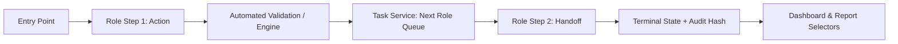

# VAYOSHRESHTHA — End-to-End Business Processes (P1 through P15)

**Version**: 4.0.0  
**Status**: Canonical Specification  
**Architecture**: Mock-API + Task Inbox + Single Event Store + Audit Hash Chain  

> [!NOTE] Non-Legal & Non-Clinical Advice Notice: Vayoshreshtha is a digital care coordination platform operated by the non-profit organization Vayoh Vikas. It does not provide legal, clinical, or financial advice. All legal consultations are referred to independent pro-bono advocates; all medical and biomarker alerts are non-clinical and must be evaluated by licensed medical professionals. Access controls are DPDP-aligned (prototype).

---

## Process Overview & Architecture

Every operational workflow in Vayoshreshtha operates as a stateful, event-driven process. Human steps are mediated through the **Task Service (`src/services/taskService.ts`)**, surfacing in **My work (`/inbox`)** for designated roles or shared queue pools. Automated transitions emit typed domain events to the single event store, triggering UI updates, notifications, and SHA-256 audit log entries.

---

## P1: Senior Citizen Onboarding (Three Channels)

- **Purpose**: Identify, consent, register, and welcome older adults into the chapter ecosystem with zero duplicate records and DPDP-aligned (prototype) data handling.
- **Channels**:
  1. *WhatsApp Chatbot* (Self-registration by senior or family member).
  2. *Assisted Web Wizard* (Chapter volunteer or Chapter Manager at Ekta Hub).
  3. *Field Capture* (Senior Field Associate on offline mobile terminal with double consent).
- **Actors**: Senior Citizen (`SC`), Volunteer Facilitator (`VF`), Chapter Manager (`CM`), Programme Manager (`PM`), Senior Field Associate (`SF`).
- **Entry Points**: `+ Create > New Senior`, `/onboarding/new`, `/field/onboard`, WhatsApp `/simulator`.
- **Human Steps**:
  1. *Capture*: VF/CM enters basic demographic details (name, DOB/age, gender, address, language, primary phone, emergency NOK contact).
  2. *Consent 1 (In-Person / Direct)*: Record explicit informed consent checkbox with timestamp.
  3. *Duplicate Resolution (if flagged)*: PM reviews potential match queue at `/seniors/duplicates` with side-by-side comparison. Action: `Confirm Unique` or `Merge into Existing`.
  4. *Welcome & Chapter Induction*: CM assigns primary Ekta Hub and initial programmes.
- **Automated Steps**:
  1. Phone normalization (`+91` format) and cryptographic Luhn-like member ID generation (`VV-HBL-26-XXXXX`).
  2. Levenshtein + Phone phonetic duplicate evaluation.
  3. Consent record dispatch and Welcome WhatsApp message enqueueing.
  4. Automatic enrollment into Chapter baseline wellness check-in roster.
- **Handoffs**:
  - If duplicate score $\ge 0.75$: Generates `Task { type: 'DUPLICATE_REVIEW', assigneeRole: 'PM', priority: 'High', sla: '24h' }`.
- **SLA & Timers**:
  - Duplicate resolution SLA: 24 hours.
  - Welcome message delivery SLA: 5 minutes from approval.
- **Exceptions & Cancellation**:
  - *Duplicate Confirmed*: Registration cancelled; existing record annotated.
  - *Consent Refused*: In-flight data purged immediately per DPDP rule.
- **Terminal States**:
  - `Registered` (Active member, card printable, ID issued).
  - `Declined` (Consent denied, personal identifiers purged).
  - `Abandoned` (Incomplete draft closed after 14 days with reason `TIMEOUT`).
- **Feeds & Reports**: Updates Registered Total, Onboarding Funnel conversion rate, Stalled table, Chapter headcount.
- **Audit**: Logged as `MEMBER_REGISTERED` or `MEMBER_PURGED` with SHA-256 hash.

---

## P2: Emergency SOS & Multi-Tier Escalation

- **Purpose**: Provide immediate life-safety triage, response dispatch, and family notification with guaranteed fallback during connectivity loss.
- **Actors**: Senior (`SC`), Volunteer (`VF`), Care Triage Staff (`CT`), Chapter Manager (`CM`), Regional Admin (`RA`), National Manager (`NM`).
- **Entry Points**: Senior Portal SOS button, WhatsApp simulator `SOS` trigger, Staff On-Behalf trigger (`/sos/board > Trigger Emergency`).
- **Human Steps**:
  1. *Acknowledge*: CT/CM clicks `Acknowledge emergency` on Live Board (`/sos`) within SLA.
  2. *Assess & Dispatch*: CT speaks to senior / NOK via telephone, assigns responder (Local Volunteer or Ambulance).
  3. *Triage Note*: CT enters operational status note and updates condition.
  4. *Resolve*: CT marks case resolved with outcome code.
  5. *Post-Case Review (Mandatory)*: CM completes 24h follow-up review checklist at `/sos/:id/review` to officially close file.
- **Automated Steps**:
  1. BroadcastChannel real-time dispatch across all open staff sessions with audio chime.
  2. Cellular fallback decision: If WhatsApp ACK not received within 60 seconds, fallback SMS triggered via cellular gateway mock.
  3. Escalation timer: If unacknowledged at 120s $\to$ escalate to Regional Admin (`RA`); at 300s $\to$ escalate to National Manager (`NM`).
- **Handoffs**:
  - On trigger: `Task { type: 'SOS_ACKNOWLEDGE', roleQueue: 'CT', priority: 'Critical', sla: '2m' }`.
  - On escalation: Reassigned to `RA` queue.
  - On resolution: Generates `Task { type: 'SOS_POST_REVIEW', assigneeRole: 'CM', priority: 'Medium', sla: '24h' }`.
- **Terminal States**:
  - `Resolved` (Assistance provided, outcome documented).
  - `False Alarm` (Accidental trigger verified by phone call).
  - `Cancelled by Senior` (Self-cancelled within 30s confirmation grace period).
- **Feeds & Reports**: Updates Open SOS count, Median Ack Time, Fallback SMS Ratio, Chapter Incident Rate.
- **Audit**: Every state change logged with sub-second timestamps and actor IDs.

---

## P3: Daily Health Routine & Biomarker Triage

- **Purpose**: Preventive tracking of vitals (Blood Pressure, Blood Glucose, Pulse) and medication adherence via automated WhatsApp prompts.
- **Actors**: Senior (`SC`), Volunteer (`VF`), Care Triage Staff (`CT`), Chapter Manager (`CM`).
- **Entry Points**: Automated scheduled cron, WhatsApp response simulator, Manual reading entry (`/health/queue > Log Reading`).
- **Human Steps**:
  1. *Review Flag*: When a reading enters `High-Risk` band, CT opens `/health/queue?tab=flags`.
  2. *Wellness Outreach*: CT conducts phone call, records clinical symptoms, notes physician consult.
  3. *Action*: Mark resolved, schedule follow-up visit, or escalate to Emergency SOS if hypertensive crisis / shock symptoms present.
- **Automated Steps**:
  1. Scheduled WhatsApp prompt dispatched according to senior's personalized regimen (e.g. 08:00 AM).
  2. NLP/Regex Parser evaluates incoming reading string (`"140/90"` $\to$ Systolic: 140, Diastolic: 90).
  3. Classification into Risk Bands:
     - Normal: Systolic < 130, Diastolic < 85.
     - Watch: Systolic 130–139, Diastolic 85–89.
     - High-Risk: Systolic 140–179, Diastolic 90–119 $\to$ Triggers Flag & Wellness Call task.
     - Critical: Systolic $\ge$ 180 or Diastolic $\ge$ 120 $\to$ Auto-escalates to SOS Case.
- **Handoffs**:
  - High-Risk reading creates: `Task { type: 'WELLNESS_CALL', roleQueue: 'CT', priority: 'High', sla: '4h' }`.
- **Terminal States**:
  - `Logged Normal` (Stored in telemetry and profile).
  - `Flag Resolved` (Outreach completed, advice given, doctor appointment logged).
  - `Escalated to SOS` (Emergency protocol triggered).
- **Feeds & Reports**: Adherence Rate %, Anomaly Frequency, Chapter Health Heatmap.

---

## P4: Community Programme Lifecycle & Attendance

- **Purpose**: Plan, schedule, register, conduct, and verify attendance for community engagement, yoga, and digital literacy sessions.
- **Actors**: Programme Manager (`PM`), Chapter Manager (`CM`), Volunteer Facilitator (`VF`).
- **Entry Points**: `+ Create > New Programme`, `/programmes/new`, `/schedule`.
- **Human Steps**:
  1. *Programme Definition*: PM sets capacity, schedule recurrence, chapter location, and objectives.
  2. *Session Attendance*: On session day, VF marks presence/absence on mobile or desktop tablet at `/attendance/session/:id`.
  3. *Lock Session*: VF submits final attendance sheet; session locks after 2 hours.
  4. *Attendance Correction*: If an attendee was missed, VF submits correction request at `/attendance?tab=corrections` with reason.
  5. *Correction Approval*: CM reviews and approves or rejects correction.
  6. *Drop-Off Outreach*: System identifies seniors missing 3 consecutive sessions; VF receives check-in task.
- **Automated Steps**:
  1. Reminder WhatsApp sent to enrolled seniors 24h and 2h before session.
  2. Automated capacity enforcement (waitlist promotion upon cancellation).
  3. Automated calculation of Chapter Attendance Index.
- **Handoffs**:
  - Attendance Correction creates: `Task { type: 'ATTENDANCE_CORRECTION_APPROVAL', assigneeRole: 'CM', priority: 'Low', sla: '48h' }`.
  - Drop-off trigger creates: `Task { type: 'DISENGAGEMENT_OUTREACH', assigneeRole: 'VF', priority: 'Medium', sla: '72h' }`.
- **Terminal States**:
  - `Completed` (Session conducted, attendance locked and verified).
  - `Cancelled` (Session cancelled in advance; enrolled members notified automatically).
- **Feeds & Reports**: Attendance Rate %, Chapter Engagement Index, Programme Retention Curve.

---

## P5: Communication Campaign & Template Approvals

- **Purpose**: Broadcast vital advisories, weather warnings, and health education to seniors with DPDP consent enforcement and maker-checker quality control.
- **Actors**: Programme Manager (`PM`), National Manager (`NM`), Chapter Manager (`CM`), System Admin (`SA`).
- **Entry Points**: `+ Create > New Announcement`, `/communication/announcements/new`.
- **Human Steps**:
  1. *Drafting*: PM creates announcement draft, selects targeted audience (by chapter, age band, language), and drafts template with dynamic variable chips (`{{senior_name}}`, `{{chapter_name}}`).
  2. *Submission*: PM submits template for governance review.
  3. *Maker-Checker Review*: NM reviews template at `/admin/approvals`. Action: `Approve` or `Reject with Feedback`.
  4. *Dispatch*: Once approved, scheduled broadcast dispatches during permissible hours (08:00–21:00).
- **Automated Steps**:
  1. Consent filter strips recipients who have opted out of broadcast messaging.
  2. Quiet hours guard: If scheduled send falls between 21:00 and 08:00, automatically deferred to 08:00 next day.
  3. Gateway mock delivery and read-receipt tracking (`Sent` $\to$ `Delivered` $\to$ `Read`).
- **Handoffs**:
  - Campaign creation creates: `Task { type: 'TEMPLATE_APPROVAL', assigneeRole: 'NM', priority: 'Medium', sla: '24h' }`.
- **Terminal States**:
  - `Sent` (Broadcast dispatched to allowlisted recipients).
  - `Cancelled` (Withdrawn by maker prior to dispatch).
  - `Rejected` (Denied by NM with revision instructions).
- **Feeds & Reports**: Delivery Rate %, Opt-out Trends, Campaign Reach Score.

---

## P6: Service Request Routing & Digital Voucher Fulfillment

- **Purpose**: Connect vulnerable seniors to partner diagnostic labs, nutrition supplies, and assistive devices via capacity-aware routing and Crockford-32 vouchers.
- **Actors**: Senior (`SC`), Volunteer (`VF`), Service Partner (`SP`), Programme Manager (`PM`).
- **Entry Points**: `+ Create > Service Request`, `/services/requests/new`, Senior Portal `/me/services`.
- **Human Steps**:
  1. *Request Initiation*: Senior or VF requests specific diagnostic test or mobility device.
  2. *Deterministic Routing*: Engine evaluates partner capacity, geographic proximity, and service score; proposes optimal partner.
  3. *Partner Acceptance*: Partner reviews intake at `/partner/referrals` and accepts within 48h SLA.
  4. *Voucher Issuance*: System generates Crockford Base-32 voucher code (e.g. `VCH-26-8942-D`).
  5. *Redemption*: Partner verifies and redeems voucher at `/partner/vouchers/redeem` upon providing service.
- **Automated Steps**:
  1. Crockford Modulo-37 checksum validation to prevent typographical errors.
  2. Idempotent redemption lock preventing double-spending.
  3. Automatic capacity decrement for partner organization.
- **Handoffs**:
  - Service request creates: `Task { type: 'PARTNER_REFERRAL_ACTION', assigneeRole: 'SP', priority: 'High', sla: '48h' }`.
- **Terminal States**:
  - `Redeemed` (Service rendered, verified via terminal).
  - `Declined` (Partner at capacity; routed to secondary partner).
  - `Expired` (Voucher unredeemed after validity window; funds de-allocated).
- **Feeds & Reports**: Referral Fulfillment Rate %, Voucher Utilization %, Partner Response Times.

---

## P7: Pro-Bono Encrypted Legal Intake

- **Purpose**: Facilitate confidential pro-bono consultation requests (property disputes, elder neglect, pension queries) with non-legal-advice notices and DPDP-aligned (prototype) access isolation.
- **Actors**: Senior (`SC`), Chapter Manager (`CM`), Pro-Bono Advocate (`SP`), Legal Lead.
- **Entry Points**: `/legal-intake/new`, `/me/support`.
- **Human Steps**:
  1. *Intake*: Senior or CM logs intake. Plain staff view only non-confidential metadata (Category: Property, Urgency: High).
  2. *Advocate Assignment*: System assigns credentialed pro-bono advocate.
  3. *Confidentiality Isolation*: Only the assigned advocate decrypts the confidential narrative using in-browser session keys.
  4. *Consultation & Case Closure*: Advocate conducts legal session, records standard closure code (`SETTLED`, `LITIGATION_REFERRED`, `COUNSELED`).
- **Automated Steps**:
  1. Client-side envelope encryption for case narrative.
  2. Permanent non-legal-advice notice injected into all exports and views.
- **Handoffs**:
  - Generates: `Task { type: 'LEGAL_CONSULTATION', assigneeRole: 'SP', priority: 'High', sla: '72h' }`.
- **Terminal States**:
  - `Closed Resolved` (Advise given, document drafted, or dispute settled).
  - `Referred to Statutory Authority` (Police or Legal Services Authority informed).
  - `Withdrawn by Client` (Senior requested closure).
- **Feeds & Reports**: Legal demand category distribution (aggregate only, $k \ge 5$).

---

## P8: Virtual Literacy Delivery & Mastermind Quizzes

- **Purpose**: Deliver accessible daily micro-lessons (Digital Payments, Fake News, Cyber Safety, Pension Portal) with interactive quizzes and quiet hours enforcement.
- **Actors**: Programme Manager (`PM`), National Manager (`NM`), Senior Citizen (`SC`).
- **Entry Points**: `/learning/library/new`, `/learning/series/new`.
- **Human Steps**:
  1. *Curriculum Authoring*: PM creates 4-step micro-lesson with simulated WhatsApp preview frames.
  2. *Content Review*: NM approves curriculum for publication.
  3. *Weekly Mastermind*: Seniors participate in timed chapter quiz at `/me/quizzes`.
- **Automated Steps**:
  1. Drip schedule delivery strictly during 08:00–21:00 window.
  2. Immediate evaluation of quiz answers with instant encouraging feedback.
  3. Anonymous chapter-level aggregation for leaderboard ranking.
- **Handoffs**:
  - Lesson creation creates: `Task { type: 'CURRICULUM_APPROVAL', assigneeRole: 'NM', priority: 'Low', sla: '48h' }`.
- **Terminal States**:
  - `Completed` (Senior finished 100% of micro-modules in series).
  - `Archived` (Curriculum version retired).
- **Feeds & Reports**: Micro-lesson Reach, Quiz Completion Rate %, Chapter Digital Literacy Index.

---

## P9: Field Associate Lifecycle & Supervision

- **Purpose**: Manage the recruitment, training, mobile terminal provisioning, and supervisory oversight of Senior Field Associates (`SF`).
- **Actors**: Programme Manager (`PM`), Chapter Manager (`CM`), Senior Field Associate (`SF`).
- **Entry Points**: `/field-network/associates/new`, `/admin/users/new`.
- **Human Steps**:
  1. *Roster Provisioning*: CM invites associate, assigns target chapter and ward geography.
  2. *Field Sync Review*: CM reviews late-sync warnings (>24h without terminal sync) at `/field-network/sync`.
  3. *Supervisor Verification*: CM confirms second-consent receipts collected by field associate.
- **Automated Steps**:
  1. WebCrypto AES-GCM 256-bit client-side local cache encryption on mobile terminal.
  2. Coarse 2-decimal geo-stamping (~1.1 km radius) preventing invasive continuous location tracking.
  3. Offline sync queue engine with automatic retry upon network reconnection.
- **Handoffs**:
  - Late-sync flag creates: `Task { type: 'SUPERVISOR_SYNC_CHECK', assigneeRole: 'CM', priority: 'Medium', sla: '12h' }`.
- **Terminal States**:
  - `Active` (Trained and actively collecting verified registrations).
  - `Suspended` (Sync discrepancies or missing consents; access blocked).
  - `Deactivated` (Offboarded from field operations).
- **Feeds & Reports**: Active Field Gigs, Last-Mile Sync Latency, Chapter Field Output.

---

## P10: Maker-Checker Governance Approvals

- **Purpose**: Prevent unauthorized changes to safety parameters, broadcast templates, voucher budgets, and staff permissions through dual-control authorization.
- **Actors**: Submitting Maker (Any Staff Role), Approving Checker (National Manager `NM` or System Admin `SA`).
- **Entry Points**: `/admin/approvals`, Contextual Save actions.
- **Human Steps**:
  1. *Submission*: Maker initiates sensitive operation (e.g. SOS timeout adjustment, new medication threshold rule).
  2. *Checker Queue*: Appears immediately in Checker's `/inbox` and `/admin/approvals`.
  3. *Review*: Checker views exact diff comparison. Action: `Approve` (applies change live) or `Reject` (requires comment).
- **Automated Steps**:
  1. Strict maker-checker block: A user can never approve their own submission (`maker_id !== checker_id`).
  2. Audit hash chain entry written with cryptographic linkage.
- **Handoffs**:
  - Generates: `Task { type: 'GOVERNANCE_APPROVAL', assigneeRole: 'NM', priority: 'High', sla: '24h' }`.
- **Terminal States**:
  - `Approved` (Configuration merged and operational).
  - `Rejected` (Returned to maker with recorded reason).
  - `Withdrawn` (Revoked by maker prior to evaluation).
- **Feeds & Reports**: Governance Queue Latency, Approval Acceptance Ratio.

---

## P11: Data-Subject Access & Deletion Requests (DPDP)

- **Purpose**: Fulfill citizens' DPDP-aligned (prototype) requests to view, rectify, or purge their personal data.
- **Actors**: Senior Citizen (`SC`), Family Member (`FM`), Governance Lead (`NM`), System Admin (`SA`).
- **Entry Points**: Senior Portal `/me/profile`, `/admin/data-governance/new`.
- **Human Steps**:
  1. *Request Initiation*: Senior requests data export or complete account deletion.
  2. *Verification & Approval*: NM verifies identity and legal authority; approves request.
  3. *Execution*: SA triggers automated purge or download generation.
- **Automated Steps**:
  1. Hard purge of PII (names, phone numbers, addresses, biometric readings) while retaining zero-PII counts in aggregate statistical series.
  2. Delivery of signed receipt confirming compliance.
- **Handoffs**:
  - Generates: `Task { type: 'DPDP_REQUEST_ACTION', assigneeRole: 'SA', priority: 'High', sla: '72h' }`.
- **Terminal States**:
  - `Purged` (PII irrevocably wiped, audit receipt generated).
  - `Exported` (Encrypted data archive delivered).
  - `Rejected Legitimate Reason` (Ongoing medical emergency or active legal dispute).
- **Feeds & Reports**: DPDP Fulfillment Rate %, Compliance Audit Log.

---

## P12: Citizen & Volunteer Complaints

- **Purpose**: Transparent dispute resolution and grievance redressal for elder abuse reports, volunteer misconduct, or service failures.
- **Actors**: Complainant (Any Role / Citizen), Grievance Officer (`NM` / `CM`).
- **Entry Points**: `/admin/complaints/new`, Help menu `Report an Issue`.
- **Human Steps**:
  1. *Lodge Complaint*: User submits complaint with severity category.
  2. *Investigation*: Assigned officer interviews parties and adds internal notes to investigation thread.
  3. *Resolution*: Officer records remediation action and communicates outcome to complainant.
- **Automated Steps**:
  1. Automatic assignment based on complaint category and chapter scope.
  2. Escalation trigger if unresolved past 7 days.
- **Handoffs**:
  - Generates: `Task { type: 'COMPLAINT_INVESTIGATION', assigneeRole: 'CM', priority: 'Medium', sla: '7d' }`.
- **Terminal States**:
  - `Resolved with Action` (Remediation taken, acknowledged by complainant).
  - `Closed Without Action` (Unsubstantiated or outside scope; justified in notes).
- **Feeds & Reports**: Grievance Resolution Time, Chapter Complaint Density.

---

## P13: Impact Pack Publication & Public Verification

- **Purpose**: Assemble audited programme impact metrics into a tamper-evident SHA-256 PDF report verifiable by CSR funders without credentials.
- **Actors**: Programme Manager (`PM`), National Manager (`NM`), CSR Funder (`CD`), Public / Auditor.
- **Entry Points**: `/telemetry/packs/new`, `/telemetry/packs/:id`.
- **Human Steps**:
  1. *Draft Pack*: PM selects reporting period, chapters, and templates (e.g. CSR Quarterly, Health Outcomes).
  2. *Submit for Release*: PM submits pack for executive sign-off.
  3. *Release Sign-Off*: NM signs and releases pack.
  4. *Verification*: Third-party auditor navigates to unauthenticated portal `/verify` and enters verification code or uploads document to confirm authenticity.
- **Automated Steps**:
  1. In-browser client-side WebCrypto SHA-256 cryptographic digest generation.
  2. $k \ge 5$ cell suppression to guarantee zero PII leakage.
  3. Immediate registration into public verification registry.
- **Handoffs**:
  - Generates: `Task { type: 'IMPACT_PACK_RELEASE', assigneeRole: 'NM', priority: 'Medium', sla: '48h' }`.
- **Terminal States**:
  - `Released` (Active and publicly verifiable at `/verify`).
  - `Revoked` (Superseded by corrected version; verification flag displays warning).
- **Feeds & Reports**: Verifiable Metric Store, CSR Donor Dashboard.

---

## P14: Service Partner Onboarding & Accreditation

- **Purpose**: Vet, credential, contract, and activate NGO, diagnostic, and legal partners into the deterministic routing network.
- **Actors**: Programme Manager (`PM`), National Manager (`NM`), Service Partner (`SP`).
- **Entry Points**: `/partners/new`, `/admin/approvals`.
- **Human Steps**:
  1. *Partner Profiling*: PM records partner legal entity, 80G/12A registrations, and service catalog.
  2. *Document Review*: PM verifies licenses and service level agreements.
  3. *Activation Approval*: NM approves partner for active intake.
  4. *Roster Assignment*: Partner administrator configures staff capacity and operating hours.
- **Automated Steps**:
  1. Injection into deterministic routing pool algorithms.
  2. Credential generation for Partner Portal (`/partner/home`).
- **Handoffs**:
  - Generates: `Task { type: 'PARTNER_ACCREDITATION', assigneeRole: 'NM', priority: 'Medium', sla: '5d' }`.
- **Terminal States**:
  - `Active` (Receiving routing requests).
  - `Suspended` (Temporarily paused due to capacity or quality review).
  - `Terminated` (Permanently removed from routing network).
- **Feeds & Reports**: Active Partner Capacity, Network Coverage Matrix.

---

## P15: Chapter Setup & Go-Live Pilot Readiness

- **Purpose**: Provision new Ekta Hubs, assign staff rosters, configure localized thresholds, and evaluate live readiness criteria before operational launch.
- **Actors**: Chapter Manager (`CM`), Regional Admin (`RA`), National Manager (`NM`), System Admin (`SA`).
- **Entry Points**: `/chapters/new`, `/admin/settings?tab=pilot-readiness`.
- **Human Steps**:
  1. *Chapter Setup*: RA defines hub locality, meeting venue, and jurisdictional wards.
  2. *Roster Staffing*: CM assigns at least 1 Volunteer Facilitator, 1 Care Triage, and 1 Field Associate.
  3. *Threshold Alignment*: CM verifies vitals rules and emergency escalation tiers.
  4. *Go-Live Milestone*: NM reviews real-time **Pilot Readiness Checklist**; clicks `Authorize Go-Live` when all checks pass green.
- **Automated Steps**:
  1. Live evaluation of readiness criteria:
     - Staff roster populated ($\ge 3$ active staff).
     - Emergency escalation chain verified.
     - Approved message templates in local regional language.
     - Seeded initial cohort ($\ge 20$ members).
  2. Real-time checklist failure links directly to remediation screen.
- **Handoffs**:
  - Readiness check failure generates remediation tasks for CM.
  - Final milestone generates: `Task { type: 'GO_LIVE_AUTHORIZATION', assigneeRole: 'NM', priority: 'High', sla: '24h' }`.
- **Terminal States**:
  - `Live & Operational` (Authorized for daily senior-care operations).
  - `Provisioning / In-Setup` (Readiness criteria incomplete; flagged in red).
- **Feeds & Reports**: Active Chapters Count, National Rollout Timeline.

---

## Process State Machine Summary

| Process ID | Name | Primary Queue | Typical SLA | Terminal States |
|---|---|---|---|---|
| **P1** | Senior Onboarding | `PM` (Duplicates), `CM` (Welcome) | 24h | `Registered`, `Declined`, `Abandoned` |
| **P2** | Emergency SOS | `CT` / `CM` (SOS Triage Pool) | 2 min | `Resolved`, `False Alarm`, `Cancelled` |
| **P3** | Daily Health Routine | `CT` (Wellness Outreach) | 4h | `Logged Normal`, `Flag Resolved`, `Escalated to SOS` |
| **P4** | Programme Lifecycle | `CM` (Corrections), `VF` (Drop-off) | 48h | `Completed`, `Cancelled` |
| **P5** | Communication Campaign | `NM` (Template Maker-Checker) | 24h | `Sent`, `Cancelled`, `Rejected` |
| **P6** | Service Request Routing | `SP` (Referral Intake) | 48h | `Redeemed`, `Declined`, `Expired` |
| **P7** | Legal Intake | `SP` (Pro-Bono Advocate Pool) | 72h | `Closed Resolved`, `Referred`, `Withdrawn` |
| **P8** | Learning Delivery | `NM` (Curriculum Approval) | 48h | `Completed`, `Archived` |
| **P9** | Field Associate Lifecycle | `CM` (Sync & Consent Check) | 12h | `Active`, `Suspended`, `Deactivated` |
| **P10** | Maker-Checker Approvals | `NM` / `SA` (Governance Queue) | 24h | `Approved`, `Rejected`, `Withdrawn` |
| **P11** | Data-Subject Request | `SA` (Purge Execution) | 72h | `Purged`, `Exported`, `Rejected Legitimate Reason` |
| **P12** | Complaints | `CM` / `NM` (Grievance Pool) | 7d | `Resolved with Action`, `Closed Without Action` |
| **P13** | Impact Reporting | `NM` (Release Sign-off) | 48h | `Released`, `Revoked` |
| **P14** | Partner Onboarding | `NM` (Accreditation Sign-off) | 5d | `Active`, `Suspended`, `Terminated` |
| **P15** | Chapter Go-Live Readiness| `NM` (Go-Live Milestone) | 24h | `Live & Operational`, `Provisioning` |

